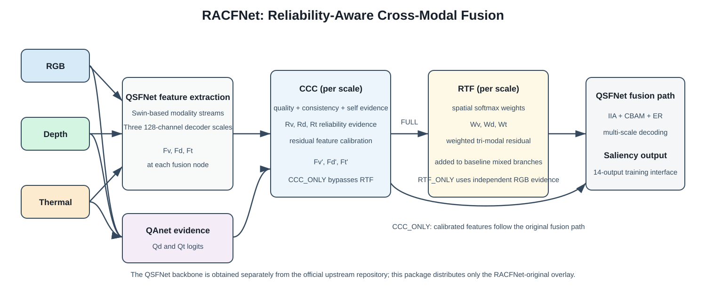

# RACFNet

**RGB-D-T Salient Object Detection for Robotic Visual Perception via Reliability-Aware Cross-Modal Fusion**

RACFNet is a research extension of QSFNet for visible-depth-thermal salient
object detection. It introduces two reliability-oriented components while
preserving the accepted QSFNet training and decoding semantics:

- **Cross-Modal Consistency Calibration (CCC)** combines learned quality,
  cross-modal agreement and self-evidence to calibrate modality features with
  a residual update.
- **Reliability-Aware Tri-Modal Fusion (RTF)** predicts spatial RGB/depth/
  thermal softmax weights and injects a weighted residual at three decoder
  fusion nodes.

The manuscript is under preparation. No DOI, volume, issue, pages or public
checkpoint URL is claimed here.

## Licensing boundary

The official [QSFNet repository](https://github.com/Lx-Bao/QSFNet) currently
does not provide an explicit software license. This repository therefore does
**not** redistribute the QSFNet backbone, dataset loader or original training
files. It contains the RACFNet-original modules, a narrow integration patch,
experiment drivers, evaluation code, configurations, result tables and
derived plots. Obtain QSFNet directly from its authors before installing this
overlay. See [LICENSE.md](LICENSE.md), [LICENSE_STATUS.md](LICENSE_STATUS.md)
and [THIRD_PARTY_NOTICES.md](THIRD_PARTY_NOTICES.md).

## Architecture



At each of three 128-channel decoder scales, CCC estimates modality evidence
and applies residual feature calibration. FULL then passes the calibrated
features and reliability evidence to RTF. RTF_ONLY uses its own RGB-quality
prediction layer together with QAnet depth/thermal evidence. The resulting
residual augments the original QSFNet mixed branches before IIA, CBAM and ER.

The learned RTF weights are not assumed to be balanced probabilities of
sensor correctness. In the accepted RTF_ONLY experiment, several scales were
highly saturated; this limitation is retained in the released statistics.

## Repository contents

```text
racfnet/       RACFNet-original CCC and RTF modules
patches/       Minimal patch integrating the modules into a local QSFNet copy
tools/         Bounded overlay installer
round2/        FULL training, inference and validation drivers
round3/        CCC_ONLY and RTF_ONLY ablation drivers
scripts/       Round4 robustness/mechanism-analysis scripts
evaluation/    Eight-metric evaluation utilities
configs/       Formal B0, CCC_ONLY, RTF_ONLY and FULL configurations
results/       Locked Round1-Round4 tables and compact mechanism summaries
figures/       Architecture SVG and derived degradation curves
checkpoints/   Expected filenames and SHA-256 values; no weights
```

## Environment

The accepted runs used Linux, Python 3.10, PyTorch 2.2.1, CUDA 12.1, an
NVIDIA RTX 4090 and 384 x 384 inputs. Install a CUDA-enabled PyTorch build
compatible with the local driver, then install the remaining dependencies:

```bash
python -m venv .venv
source .venv/bin/activate
python -m pip install --upgrade pip
python -m pip install -r requirements.racfnet.txt
```

Windows PowerShell activation is `.venv\Scripts\Activate.ps1`.

## Installation with the official QSFNet source

```bash
git clone https://github.com/Lx-Bao/QSFNet.git
git clone https://github.com/hylandelisandro-droid/RACFNet.git RACFNet
python RACFNet/tools/install_into_qsfnet.py --qsfnet QSFNet --racfnet RACFNet
cd QSFNet
python -m pip install -r requirements.racfnet.txt
```

The installer copies only RACFNet-owned files, creates
`round2/RACFNet.py` from the user's local `Tnet.py`, verifies patch
compatibility with `git apply --check`, and then applies the integration
patch. It does not overwrite the upstream `Tnet.py`. Detailed instructions
are in [INSTALLATION.md](INSTALLATION.md).

## VDT-2048 preparation

Obtain VDT-2048 through its official distribution channel and use the layout
expected by QSFNet:

```text
VDT-2048/
  Train/{V,D,T,GT,eg}/
  Test/{V,D,T,GT}/
```

The project does not redistribute VDT-2048. `V`, `D` and `T` denote visible,
depth and thermal images. Do not infer the 14 official challenge attributes
from image appearance.

## Checkpoints

Checkpoints are not included and no public download URL is currently
available. Place locally obtained files outside Git as documented in
[checkpoints/README.md](checkpoints/README.md). The accepted identities are:

- `B0_Tnet_final.pth`
- `QAnet_final.pth`
- `FULL_RACFNet_final.pth`
- `CCC_ONLY_RACFNet_final.pth`
- `RTF_ONLY_RACFNet_final.pth`

The documentation records their locked SHA-256 values so future downloads can
be checked without substituting intermediate epochs.

## Inference

After installing the overlay into QSFNet, run from the QSFNet root. FULL uses:

```bash
python round2/round2_infer.py \
  --repo . \
  --data-root /path/to/VDT-2048 \
  --qanet /path/to/QAnet_final.pth \
  --model /path/to/FULL_RACFNet_final.pth \
  --b0-pred /path/to/B0_predictions \
  --output outputs/full \
  --artifact-dir outputs/full_artifacts \
  --workers 4
```

For one-module ablations:

```bash
python round3/round3_infer.py \
  --mode CCC_ONLY \
  --repo . \
  --data-root /path/to/VDT-2048 \
  --qanet /path/to/QAnet_final.pth \
  --model /path/to/CCC_ONLY_RACFNet_final.pth \
  --b0-pred /path/to/B0_predictions \
  --full-pred /path/to/FULL_predictions \
  --output outputs/ccc_only \
  --artifact-dir outputs/ccc_only_artifacts \
  --workers 4
```

Use `--mode RTF_ONLY` and the corresponding checkpoint/output paths for RTF.

## Evaluation

The accepted evaluator reports S-measure, MAE, adaptive/mean/max E-measure,
and adaptive/mean/max F-measure:

```bash
python evaluation/round2_evaluate.py \
  --pred-dir outputs/full \
  --gt-dir /path/to/VDT-2048/Test/GT \
  --out-dir outputs/full_metrics \
  --source RACFNet_FULL \
  --baseline-metrics /path/to/B0_EIGHT_METRICS.csv
```

The formal protocol expects exactly 1,000 matched prediction/GT pairs and uses
sigmoid output, bilinear resizing with `align_corners=True`, per-image min-max
normalization and uint8 PNG export.

## Optional training

Training is not needed for evaluation. To reproduce FULL from accepted Round1
initialization:

```bash
python round2/round2_train.py \
  --repo . \
  --data-root /path/to/VDT-2048 \
  --work-root /path/to/work \
  --qanet /path/to/QAnet_final.pth \
  --tnet /path/to/B0_Tnet_final.pth \
  --epochs 200 --batch-size 4 --workers 8 --lr 1e-4
```

Use `round3/round3_train.py --mode CCC_ONLY` or `--mode RTF_ONLY` for the
single-module configurations.

## Quantitative results on VDT-2048

Higher is better except MAE. These are the locked Round1-Round3 results from
the formal 1,000-image test protocol.

| Model | S | MAE | Eadp | Emean | Emax | Fadp | Fmean | Fmax |
|---|---:|---:|---:|---:|---:|---:|---:|---:|
| B0 | 0.939612 | 0.002158 | 0.986907 | 0.988305 | 0.991970 | 0.890273 | 0.905813 | 0.921889 |
| CCC_ONLY | 0.939858 | 0.002144 | 0.988547 | 0.988548 | 0.992070 | 0.894748 | 0.908629 | 0.922615 |
| RTF_ONLY | 0.940555 | 0.002128 | 0.988424 | 0.988983 | 0.992529 | 0.893574 | 0.908204 | 0.923569 |
| FULL | 0.940619 | 0.002135 | 0.988921 | 0.988746 | 0.992283 | 0.896082 | 0.910188 | 0.923755 |

Complete Table 1-Table 6 data and compact Round4 robustness/mechanism outputs
are under `results/`. The evidence does not justify claiming that RACFNet
outperforms QSFNet under every metric or every degradation condition.

## Derived visualizations

The `figures/` directory contains the original architecture diagram and
degradation curves derived from accepted experiment CSVs. Dataset image
composites are excluded from this code repository.

## Citation

The RACFNet manuscript is not yet published. Replace only the marked fields
after publication:

```bibtex
@article{RACFNet_TBD,
  title   = {RGB-D-T Salient Object Detection for Robotic Visual Perception via Reliability-Aware Cross-Modal Fusion},
  author  = {TBD},
  journal = {TBD},
  year    = {TBD}
}
```

Please also cite QSFNet:

```bibtex
@article{bao2024quality,
  title   = {Quality-Aware Selective Fusion Network for V-D-T Salient Object Detection},
  author  = {Bao, Liuxin and Zhou, Xiaofei and Lu, Xiankai and Sun, Yaoqi and Yin, Haibing and Hu, Zhenghui and Zhang, Jiyong and Yan, Chenggang},
  journal = {IEEE Transactions on Image Processing},
  volume  = {33},
  pages   = {3212--3226},
  year    = {2024},
  doi     = {10.1109/TIP.2024.3393365}
}
```

## Acknowledgements

RACFNet builds on the research design of QSFNet. We thank Bao et al. for the
official implementation and VDT-2048 resources. QSFNet must be downloaded
from its [official repository](https://github.com/Lx-Bao/QSFNet); no upstream
source is mirrored here.
